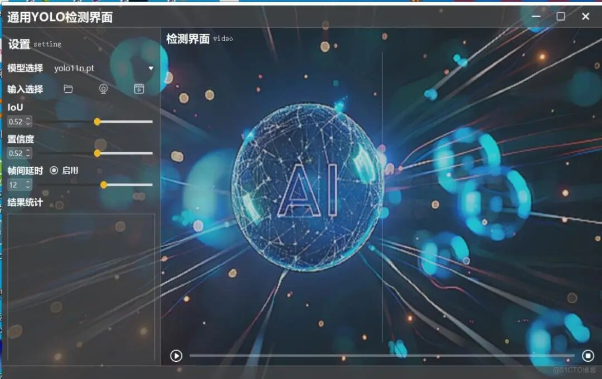
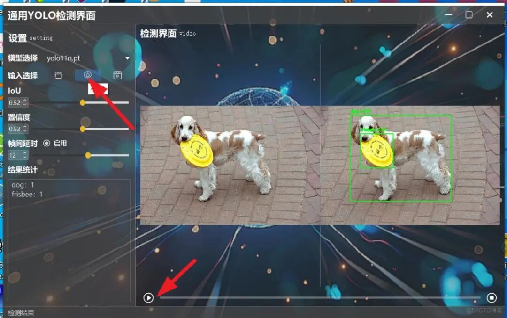
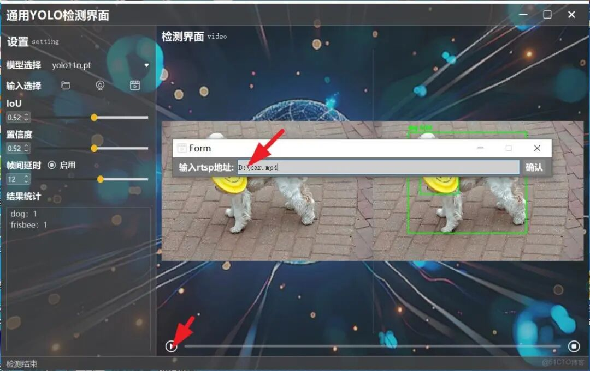

# Design a general detection interface based on pyqt5 for YOLOv8/YOLOv10/YOLOv11/YOLOv12/YOLOv13.

This project is a graphical object detection tool based on YOLO11 and PyQt5, supporting multiple input sources and model configurations. It is suitable for cultural relics recognition and image processing.

This project is a graphical object detection tool based on YOLOv11 and PyQt5, supporting multiple input sources and model configurations. It is suitable for applications such as cultural relics recognition and image detection. The code is compatible with YOLOv8/YOLOv10/YOLOv11/YOLOv12/YOLOv13, and can be seamlessly integrated by simply installing the corresponding framework ultralytics. After changing the model, it can be used again. Of course, you can also use the code for secondary development.

#### Function Characteristics

-

Supports multiple YOLOv11 models (yolo11n.pt, yolo11s.pt, yolo11m.pt, yolo11l.pt, yolo11x.pt, etc.)

-

Support for multiple input sources:

-

Local image/video files

-

Real-time camera detection

-

RTSP video stream

-

Adjustable parameters:

-

Confidence threshold

-

IoU (Intersection over Union) threshold

-

Frame rate control

-

Real-time display results:

-

Original video stream display

-

Video stream of the detection results

-

Detection object statistics list

-

Graphical interface operation, simple and easy to use

#### Environment-Dependent

-

Python 3.8

-

PyQt5

-

PyTorch 1.7.1

-

TorchVision 0.8.2

-

OpenCV-Python

-

numpy

-

matplotlib

-

Other dependencies are detailed in requirements.txt

#### Installation Steps

1.

Clone or download this project to your local machine.

1.

Create a Python virtual environment (recommended):

```
conda create -n yolo11_pyqt5 python=3.8
conda activate yolo11_pyqt5
```

1.

Dependency installation:

```
pip install -r requirements.txt
```

1.

Download the YOLOv11 pre-trained model weights and place them in the `weights` folder at the root of your project:

-

YOLOv11 model (compatible with YOLOv8/11 series)

#### Usage Method

Run the program:

```
python main.py
```

##### Interface Description



After the program starts, the main interface contains the following areas:

1. **Model Selection Area**

Select different YOLOv11 model files.

1. **Input Source Selection Area**

 : 

-

File: Select a local image or video file for detection.

-

Camera: Select a local camera device for real-time detection.

-

RTSP: Input RTSP address for network video stream detection

1. **Parameter Setting Area**

 : 

-

Confidence (Conf): Target detection confidence threshold

-

IoU: Intersection over Union threshold for Non-Maximum Suppression

-

Frame rate (Rate): Controls the detection frame rate, reducing latency.

1. **Control Button Area**

 : 

-

RUN/STOP: Start/Pause Detection

-

STOP: Stop detection

1. **Video display area**

 : 

-

Left: Original video stream

-

Right side: Detection results video stream

1. **Statistical Information Area**

Displays the number of various types of targets detected.

#### Operational Steps

1.

Select the appropriate model in the model selection dropdown (default is yolo11n.pt)

1.

Click "File" "Camera" or "RTSP" button to select input source:

-

File: Select the image or video file in the pop-up file selection dialog.

-

Camera: Select the camera device to be used from the pop-up menu.

-

RTSP: Enter the RTSP address in the pop-up input box.

1.

Adjust detection parameters (optional):

-

Adjust the confidence threshold using the Conf sliders.

-

Adjust the Intersection over Union (IoU) slider to adjust the threshold for intersection over union.

-

Adjust the detection frame rate using the Rate slider

1.

Click the "RUN/STOP" button to start the detection.

1.

During the testing process, you can click "RUN/STOP" to pause or continue the test at any time.

1.

Click the "STOP" button to stop the detection. Detecting image:

Camera detection:



Video file or RTSP stream detection:



#### Configuration File

The program will generate the following configuration files during its execution, which are saved in the `config` directory:

- `setting.json`

Save the user settings parameters (confidence, IoU, etc.)

- `fold.json`

Save the path of the recently opened file.

- `ip.json`

Save the most recently used RTSP address.

#### Notes

1.

When using RTSP streams, if there is a lag phenomenon, you can:

-

Select a smaller model (e.g., yolo11n.pt)

-

Reduce the detection frame rate

-

Enable frame skip detection (uncomment the relevant code in main.py)

1.

The program defaultly uses CUDA for acceleration. If you wish to run it on a CPU, please modify the device settings in the code.

1.

For large-sized videos, detection speed may be slower. It is recommended to use smaller models or reduce the input resolution.

#### Project Structure

```
yolo11-pyqt5/
├── weights/  # Model weight file directory
├── config/             # Configuration file directory
├── dialog/  # RTSP Dialog-related files
├── main_win/  # Main window UI file
├── utils/ # Tool Functions Directory
├── main.py             # Program entry file
├── requirements.txt  # Dependency package list
└── README.md  # Instructions
```

#### Common Issues

Q: Error message "Module not found" when the program starts.

Q: Camera cannot be opened.

Q: RTSP stream connection failed.


## Payment

Here is a pay link on Stripe ( https://buy.stripe.com/3cs8yP7sY87d0vu9AB ). Please contact me lonlonago@foxmail.com after funding $89, and I will send you a complete data files , thank you!


